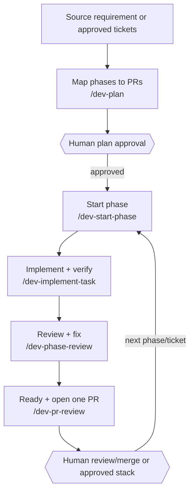
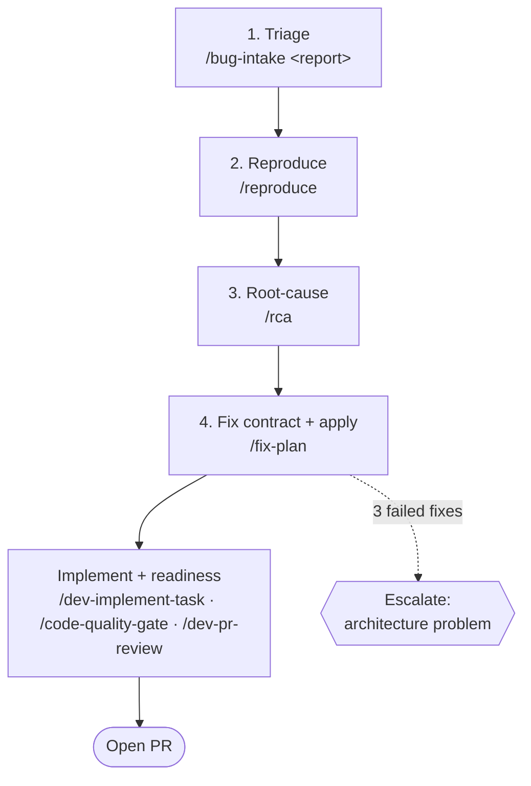

# Phase → Command Map

A quick reference for which commands each phase of a workflow uses. The toolbelt
has **three entry-point workflows** plus shared review/handoff utilities. Use
`/workflow-router` if you are unsure which command comes next.

## Phased Delivery (human-guided PRs)

Use a raw requirement, existing approved plan, or approved project tickets.
Each selected ticket is one phase and one PR. Workflow:
`.atb/workflows/phased-delivery-workflow.md`. Skill:
`.atb/skills/phased-delivery/`. The `/dev-*` names remain compatibility commands.

| # | Step | Command |
|---|------|---------|
| 1 | Clarify only if raw input is ambiguous | `/dev-intake` (optional) |
| 2 | Map source scope to phase/PR units | `/dev-plan` |
| 3 | Human approves plan | — |
| 4 | Confirm ticket scope, branch, parent PR/base | `/dev-start-phase` |
| 5 | Implement and verify phase work | `/dev-implement-task` |
| 6 | Review and fix this phase's diff | `/dev-phase-review`, `/dev-fix-review-issues` |
| 7 | Check readiness and open this phase PR | `/dev-pr-review` |
| 8 | Human review/merge or approved stacked child | — |

## Bug-to-Fix (diagnostic / verification-first)

Four steps to a minimal fix, then the shared dev/review back half. Workflow:
`.atb/workflows/bug-to-fix-workflow.md`. Skill: `.atb/skills/bug-to-fix/`.

| # | Step | Command |
|---|------|---------|
| 1 | Triage (severity + intake) | `/bug-intake <report>` |
| 2 | Reproduce | `/reproduce` |
| 3 | Root-cause | `/rca` (`/rca --diagnose` for read-only) |
| 4 | Fix contract + apply | `/fix-plan` |
| → | Implement + readiness | `/dev-implement-task`, `/code-quality-gate`, `/dev-pr-review` |

State lives in a durable `bug-investigation.md`; use `/handoff` at any point.
Three failed fixes = treat as an architecture problem, not a fourth attempt.

## Shared utilities (any workflow)

- **Routing:** `/workflow-router` — identifies work type and routes to the next
  1–3 commands.
- **Request shaping:** `/shape-up` — interrogate a fuzzy request before planning.
- **Review:** `/pr-review` (tiered: light / standard / deep), `/pr-review-reply`,
  `/review-diff`.
- **Review triggers:** `/review-on-open` (event/poller), `/enqueue-review` +
  `/review-queue-worker` (push queue), `/phase-gate` (in-loop boundary review).
- **Tests:** `/cover`, `/cover-gaps`.
- **Cleanup:** `/simplify`, `/code-smell` (`--architecture` for no-code
  deepening candidates).
- **Release:** `/ship-it`.
- **Tickets:** `/ticket-sync`, `/to-issues`.
- **Durable state:** `/handoff`, and `/phase-create` → `/phase-start` →
  `/phase-close` / `/phase-status` for context-reset-safe phase state.
- **Retrofit:** `/retrofit` — apply one change across every site in a codebase.
