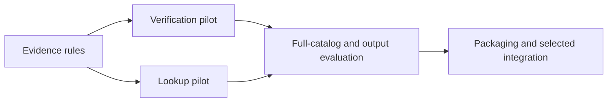

# Readable outputs — 2026-11-02

> Inventory update: The 2026-11-03 cleanup leaves 29 standard skills.
> See [the ownership and migration guide](project-workflow-boundary.md).
> Counts and check results below describe the November 2 review.

Use **tables for structured findings, diagrams for relationships, and actions
with a reason and completion check for plans**. This is now a shared authoring
standard, wired into assessment, ticket discovery, and phased delivery. The
lookup/verification designs use the same layouts; those two skills remain
proposed. Product skills remain on hold.

**Language update:** all 30 standard skills now load the shared output rules.
Repository instructions apply the same rules to replies and progress reports.
Use ASD-STE100 for new text. Keep code, exact labels, and source quotations unchanged.
The examples below record the earlier format design.

The canonical rules live in the
[human-readable output contract](../shared/contracts/references/human-readable-output.md).
This document provides examples and the external-skill decision rather than
another copy of those rules.

## Assessment of the suggested skill

The [i-have-adhd skill](https://github.com/ayghri/i-have-adhd/blob/main/skills/i-have-adhd/SKILL.md)
offers action-oriented, numbered, concise presentation. Its mode persists across
the session and includes time-estimate and list-size preferences. The repository
declares an [MIT license](https://github.com/ayghri/i-have-adhd/blob/main/LICENSE).
The skill, README, and license were browser-inspected on November 2 at mutable
`main`; no full upstream commit was resolved.

| Choice | Recommendation | Reason |
| --- | --- | --- |
| Shared output guidance | Adopt now | Gives reusable workflows consistent, reviewable results. |
| Full upstream skill | Keep available as an optional personal mode | Its persistent session behavior goes beyond the requested data/plan layouts. |
| New mandatory presentation skill | Defer | Existing owners can load one shared reference directly. |

The shared contract is independently written from the user's requirements and
the existing workflow contracts. No upstream prose or code was copied, and the
external mode was not installed or activated. Formatting preferences apply
without assuming anything about the reader's health.

## Lookup results

The short answer comes first: standard standalone PR review does not
automatically select linked-spec checking solely because a ticket is linked.

| Question | Answer | Evidence | Limits |
| --- | --- | --- | --- |
| Is linked-spec checking automatic at standard tier? | No; the automatic addition is described for deep tier. | [Facet selector](../skills/pr-review/references/fan-out.md), “Select facets” | Focus/config can select additional facets. |
| Is acceptance checked in phased delivery? | Yes, its review rules require checking every acceptance clause. | [Phase review rules](../skills/phased-delivery/references/review-rules.md), item 1 | A separate workflow instruction; this is static source inspection. |

## Verification results

The claim's outcome stays next to the evidence and the correction. An unavailable
source remains distinct from a contradicted claim.

| Claim | Outcome | Evidence and scope | Correction or next check |
| --- | --- | --- | --- |
| All 34 watched repos refreshed successfully on November 2. | Contradicted | [Refresh record](upstream-refresh-2026-11-02.json): 0 successful fetches, 34 failures. | Fetches were attempted and failed DNS; selected browser sources were read. |
| No upstream repository changed. | Insufficient evidence | Failed fetches and unchanged local HEADs do not establish remote state. | Obtain a successful upstream read for the relevant repository. |

## Plans and steps

This is the proposed build sequence, not completed implementation.

| Step | Do | Why | Done when |
| --- | --- | --- | --- |
| 1 | Implement evidence rules and the verification pilot. | Establish a consistent way to judge claims. | Fixed cases produce correct outcomes, pinpoint evidence, and visible limits. |
| 2 | Implement the lookup pilot. | Supply the evidence needed to answer repository, documentation, and workspace questions. | Scoped answers remain useful when a source is unavailable. |
| 3 | Evaluate selection, presentation, and installation. | Confirm that people can review the result and the intended workflow runs. | Cases and package checks pass; unmeasured behavior remains labeled. |

For a short sequence, numbered actions with their reason and completion signal
are sufficient. For dependencies that are hard to follow in a table, add a diagram:

These edges describe proposed dependencies, not measured system behavior.
Where Mermaid cannot render, use an edge table or numbered dependency list.

## Scope of the applied change

| Surface | Applied behavior |
| --- | --- |
| Skill authoring guidance | New text uses the shared format and ASD-STE100 language rules. |
| All 30 standard skills | Each skill loads the output rules. Each standalone installer supplies the file. |
| Technical backlog assessment | Runtime pointer and installer payload; compact options and action/reason/completion template. |
| Ticket discovery | Runtime pointer and installer payload; comparisons include an action and reason, with executable next steps. |
| Phased delivery | Runtime pointer, synchronized internal copy, installer payload, compact PR map, and per-step action/reason/completion table. |
| Proposed evidence skills | Table layouts and presentation expectations added to the existing design/case specification. |

Existing machine-readable schemas, review verdicts, approval boundaries, and
required evidence remain owned by their workflows. The standard preserves those
contracts when choosing a human-readable view.

## Validation

| Check | Result | What it establishes |
| --- | --- | --- |
| Shape, mirror sync, catalog, and generated-audit checks | Passed | Runtime references, metadata, and the synchronized Phased Delivery copy remain coherent. |
| Initial three standalone all-harness installs | Passed | The original three consumers supplied the shared file, correct reference paths, and plan templates. |
| ASD-STE100 update: 30 standalone installs | Passed | Every standard skill supplies the shared rules through its own installer. References work in each supported host. |
| ASD-STE100 update: package and source checks | Passed | Package checks, source references, installer declarations, and the Phased Delivery copy agree. |
| Cursor plugin build | Passed | The native build retains 30 skills with no default commands, hooks, or rules. |
| Source and output review | Passed as a static inspection | Table examples preserve outcomes, evidence, scope, and uncertainty; plans retain existing workflow boundaries. |

The 17 proposed evidence-skill cases now include presentation expectations.
Those cases remain unexecuted; this change does not claim measured improvement
in live agent output or activate the external personal mode.

## ASD-STE100 sources and review

The [official site](https://www.asd-ste100.org/) lists Issue 9, dated January 15, 2025.
The [official FAQ](https://asd-ste100.org/STE_faq.html) explains the dictionary and the use of technical terms.
Indexed passages from the [official PDF](https://www.asd-ste100.org/assets/files/ASD-STE100_ISSUE9.pdf)
give the sentence limits.
Direct page and PDF requests returned HTTP 403 during this update.
The source review used indexed official passages. It did not include a complete dictionary review.

The local rules apply the user's language preference.
A complete conformance review must use the full standard and dictionary.
