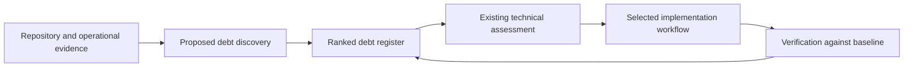
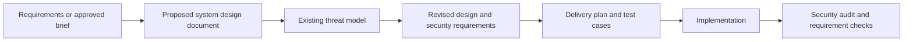

# Product, technical health, and system design packaging — 2026-11-06

Implementation update: Release `1.1.0` implements the four selected skills and the agreed existing-owner improvements.
The runtime now contains 33 standard skills and six portal workflow guides.
The original research and deferred proposals below remain dated decision evidence.

Build four focused capabilities: technical debt discovery, system design, user research synthesis, and product outcome review.
Connect them to the existing assessment, threat modeling, delivery, testing, and review owners.
Present five workflow collections in the portal before creating separate plugin packages.

This document records research and a proposed implementation order.
At the research baseline, the runtime catalog contained 29 standard skills.
The capability names below describe proposals at that research baseline.
This request resumes the product research deferred in the [November 2 review](skill-focus-review-2026-11-02.md).

**Evidence and limits.** The local baseline is commit `2fa22eb712dcc6ad45219c1b8a44c1cf48366a55`.
The review inspected canonical skills, catalog journeys, prior research, maintenance scripts, and selected primary upstream sources.
Three subagents supplied separate inventory, product, and security research.
External source links were inspected on November 6 through mutable branch URLs.
They establish available methods, but do not establish complete upstream revision freshness.
No scanners, attacks, installations, production measurements, or live skill evaluations ran.

**Current coverage.** Missing capabilities are mostly unimplemented workflows.
They are not existing standard skill files omitted from the native package.

| Requested job | Current owner and evidence | Finding |
| --- | --- | --- |
| Find technical debt worth addressing. | [simplify](../skills/simplify/SKILL.md), [architecture scanning](../shared/contracts/references/maintainability-taxonomy.md), and [CRAP analysis](../skills/crap-analysis/SKILL.md). | Partial. These supply structural, complexity, and coverage signals. No owner combines repository evidence into a maintained debt backlog. |
| Decide whether to replace a library or change code organization. | [tech-backlog-assessment](../skills/tech-backlog-assessment/SKILL.md). | Supported for a supplied item. It compares options, risks, tests, and the next workflow. |
| Apply an accepted improvement. | [simplify](../skills/simplify/SKILL.md), [retrofit](../skills/retrofit/SKILL.md), and [phased delivery](../skills/phased-delivery/SKILL.md). | Supported. Select the owner from the change scope and behavior requirements. |
| Produce a system design document. | [shape-up](../skills/shape-up/SKILL.md) produces a brief. Delivery produces an execution plan. | Missing. Neither artifact owns the complete system design. |
| Review possible system attacks before implementation. | [threat-model](../skills/threat-model/SKILL.md) and its [template](../templates/threat-model.md). | Supported in principle. The design document, revision, and verification links need a defined contract. |
| Review implemented security controls. | [security-audit](../skills/security-audit/SKILL.md). | Supported as bounded source review. It needs explicit reconciliation with the design threat IDs. |
| Learn what customers need and whether changes help. | [product-discovery](../skills/product-discovery/SKILL.md) and [shape-up](../skills/shape-up/SKILL.md). | Partial. Detailed research synthesis and outcome review remain proposals. |
| Check facts across sources. | Investigation occurs within existing workflows. | Partial. [Knowledge lookup and information verification](knowledge-verification-deep-dive-2026-11-02.md) remain proposed shared capabilities. |

The [catalog entry](../catalog/agent-toolbelt.json) currently overstates technical assessment.
It advertises backlog prioritization, while the canonical skill starts with one supplied item.
Its workflow membership is empty, and the codebase-improvement journey omits it.
Correct this entry before using the portal to judge coverage.

**Proposed packaging.** A collection describes a useful sequence and its outputs.
It does not require every listed skill on every task.
Keep the current native plugin and canonical skill tree during the first implementation.

| Collection | Existing owners | Proposed work | Main output |
| --- | --- | --- | --- |
| Product decisions and learning | `product-discovery`, `shape-up`. | Add `user-research-synthesis` and `product-outcome-review`. Extend discovery references. | Evidence, opportunity decision, experiment plan, brief, and outcome decision. |
| Technical health and modernization | Assessment, `simplify`, `crap-analysis`, `retrofit`, style guidance. | Add `tech-debt-discovery`. Extend assessment with source-to-target version analysis. | Ranked debt register, selected decision memos, and measured improvement evidence. |
| System design and security | `threat-model`, `security-audit`, test design. | Add `system-design`. Connect design revisions, threats, requirements, and verification. | Design document, threat review, security requirements, and remaining risks. |
| Delivery and verification | Phased delivery, debugging, testing, browser checks, PR review, release. | Correct existing gaps. Later add non-browser functional QA and accessibility review. | Implemented behavior and bounded verification evidence. |
| Evidence and workflow maintenance | Handoff, phase context, output contract, package checks, upstream research. | Reuse the proposed evidence contract. Add source maintenance and actual skill evaluations. | Source records, reproducible evaluations, and explicit coverage limits. |

Use portal collections and workflow pages first.
Separate plugin packages need evidence of distinct audiences, dependencies, or installation needs.
Keep cloud, identity, database, and hosting specialists optional and stack-specific.

**Technical debt discovery.** Add a report-only owner for “What should we improve in this repository?”
Keep “Should we do this particular improvement?” in `tech-backlog-assessment`.

Inspect code, module boundaries, tests, dependencies, build and deployment, operations, and documentation.
Use change history to find investigation targets where available.
Treat frequently changed or complex code as a signal, rather than proof of a defect.
Report unavailable history, runtime data, or tooling as coverage limits.

| Register field | Required content |
| --- | --- |
| Identity and scope | Use a stable candidate ID, repository revision, inspected area, owner, and observation date. |
| Evidence | Link exact locations, callers, measurements, commands, or repeated maintenance work. |
| Consequence | Describe a demonstrated failure, exposure, delay, repeated effort, or resource cost. |
| Options | Compare keeping the implementation, bounded repair, removal, replacement, or a limited investigation. |
| Priority and confidence | Explain urgency, benefit, dependencies, confidence, and effort assumptions. Avoid unsupported numerical precision. |
| Completion and review | Define the baseline, observable success condition, verification method, and reason for reassessment. |

Rank exposed security and data-integrity problems before cosmetic modernization.
Then compare recurring failures, delivery cost, affected work, change risk, and opportunity cost.
Do not force unknown impact or effort into invented scores.
Merge duplicate candidates and retain deferred decisions with their reasons.

For libraries, distinguish updates within the existing choice from replacement with another product.
Check installed versions and actual API usage before reading official migration guidance.
Compare runtime support, compatibility, maintenance, license, ecosystem fit, migration cost, and measurable benefit.
The current library can remain the recommended option.
“More modern” alone does not establish a useful change.

For code organization, inspect dependency direction, ownership, cycles, public interfaces, and changes that repeatedly cross boundaries.
Propose the smallest boundary change that addresses the observed cost.
Do not assume that a monolith needs services or that every module needs additional layers.

Anthropic's [technical debt skill](https://github.com/anthropics/knowledge-work-plugins/blob/main/engineering/skills/tech-debt/SKILL.md) supplies useful category coverage.
Its short scoring procedure does not establish local impact or effort.
Its [version-delta analyst](https://github.com/anthropics/claude-plugins-official/blob/main/plugins/code-modernization/agents/version-delta-analyst.md) supplies a stronger upgrade method.
It intersects official version changes with actual code usage and distinguishes installed tools from executed analysis.
Adapt that method within assessment.

**System design and attack review.** Make the design document and threat review paired outputs whenever the system-design workflow runs.
Scale their detail to the system.
Keep ordinary bounded edits outside a mandatory architecture process.

| Design content | Required result |
| --- | --- |
| Purpose and evidence | State goals, exclusions, constraints, current behavior, and proposed behavior. |
| Structure and flows | Show system context, components, data movement, deployment, and trust boundaries. |
| Interfaces and data | Define contracts, ownership, consistency, retries, duplicate handling, and concurrency where applicable. |
| Quality and operation | State availability, latency, capacity, recovery, monitoring, and cost assumptions. Identify unsupported estimates. |
| Options and decisions | Compare alternatives and explain important tradeoffs. Record conditions that would require another decision. |
| Security and verification | Link the reviewed revision, threat model, requirements, remaining risks, and verification plan. |

An architectural decision record explains one important design choice.
Use a separate record when its tradeoff needs a durable explanation.
Keep routine decisions in the design document.

The attack review must describe entry points, attacker access, preconditions, actions, impact, existing controls, and missing controls.
Consider identity, authorization, tenant boundaries, injection, outbound requests, secrets, supply-chain exposure, resource exhaustion, and business abuse where applicable.
For AI systems, also consider untrusted retrieved content, tool authority, stored context, and sensitive output.
Distinguish an observed control from a proposed control.

Use stable relationships such as `THREAT-01 → SEC-01 → test or configuration evidence`.
These are proposed generic identifiers, not existing project register entries.
Give every important threat a disposition, owner, and verification method.
After design changes, record whether the threat review remains applicable.
After implementation, reconcile required controls against actual code and deployment evidence.
An analytical review cannot establish that every possible attack was found.

Use [Anthropic system design](https://github.com/anthropics/knowledge-work-plugins/blob/main/engineering/skills/system-design/SKILL.md) as a concise method source.
It produces design documents but does not require an attack review.
Use [arc42](https://arc42.org/overview/) for document coverage and [C4](https://c4model.com/diagrams) for architecture views.
Use [OWASP threat modeling](https://cheatsheetseries.owasp.org/cheatsheets/Threat_Modeling_Cheat_Sheet.html) for the security review method.
Select applicable [ASVS requirements](https://asvs.owasp.org/) with their exact version and identifiers.
Use [Trail of Bits sharp-edges](https://github.com/trailofbits/skills/blob/main/plugins/sharp-edges/skills/sharp-edges/SKILL.md) to examine dangerous defaults and easily misused interfaces.

A separate project workflow was also inspected for design and cyber methods.
Keep organization-specific registers, internal links, required approvals, and document projections in that project.
The [ownership boundary](project-workflow-boundary.md) remains applicable.
The reusable toolbelt method should independently describe architecture, threats, controls, gaps, and verification.

**Product work beyond initial discovery.** Add two independent entry points and extend the existing discovery owner.

| Capability | Packaging choice | Completion condition |
| --- | --- | --- |
| User research synthesis | Add a skill. | Themes trace to supplied evidence. Preserve counterexamples, sample limits, and differences between observations and interpretation. |
| Opportunity comparison | Extend discovery references. | Compare customer consequences, evidence, strategy, dependencies, and cost. Record why an opportunity advances or waits. |
| Interview and experiment preparation | Extend discovery references. | State the decision, uncertain assumption, evidence needed, experiment limits, and success or failure conditions. |
| Measurement definition | Add a discovery reference and reusable template. | Define the event, numerator, denominator, population, exclusions, source, baseline, period, owner, and data checks. |
| Product outcome review | Add a skill. | Compare the original hypothesis with results. Report uncertainty and recommend continued investment, revision, stopping, or further evidence. |
| Delivery retrospective | Start with a workflow document. | Use actual delivery records and previous actions. Assign a small set of measurable process improvements. |

Product outcome review follows an experiment or release.
It answers whether the original customer problem improved.
Release monitoring remains in `ship-it`.
An observed metric change alone does not establish that the release caused it.

Use Anthropic's [research synthesis](https://github.com/anthropics/knowledge-work-plugins/blob/main/design/skills/research-synthesis/SKILL.md) and [metrics review](https://github.com/anthropics/knowledge-work-plugins/blob/main/product-management/skills/metrics-review/SKILL.md) as method sources.
Preserve real evidence counts and comparability limits.
Use PM Skills' [metric specification](https://github.com/phuryn/pm-skills/blob/main/pm-product-discovery/skills/metrics-dashboard/SKILL.md), [strategy challenge](https://github.com/phuryn/pm-skills/blob/main/pm-execution/skills/strategy-red-team/SKILL.md), and [retrospective](https://github.com/phuryn/pm-skills/blob/main/pm-execution/skills/retro/SKILL.md) selectively.
Review statistical formulas and repeated-testing policy before adopting its [A/B analysis](https://github.com/phuryn/pm-skills/blob/main/pm-data-analytics/skills/ab-test-analysis/SKILL.md).
Use a checked statistical implementation and an agreed experiment plan.

Wondelai's [continuous discovery](https://github.com/wondelai/skills/blob/main/continuous-discovery/SKILL.md) supplies useful outcome-to-experiment relationships.
Its [debt journey](https://github.com/wondelai/skills/blob/main/remove-technical-debt/SKILL.md) supplies incremental repair ideas.
Keep those ideas within current owners instead of adding another complete delivery framework.

**Optional tools.** Tools supply evidence; the workflow still owns interpretation and the decision.

| Tool | Useful evidence | Important limit |
| --- | --- | --- |
| [Knip](https://knip.dev/) | Unused files, dependencies, and exports in JavaScript and TypeScript. | Validate entry points, generated code, dynamic loading, and public exports before deletion. |
| [dependency-cruiser](https://github.com/sverweij/dependency-cruiser) | Dependency graphs, cycles, and violations of explicit architecture rules. | Agree intended boundaries before treating a graph edge as a defect. |
| [Renovate](https://docs.renovatebot.com/) | Dependency updates and supported package replacements. | Update availability does not decide architectural fit or migration value. |
| [OpenSSF Scorecard](https://github.com/ossf/scorecard) | Repository security practice checks for dependency evaluation. | Individual findings support investigation. An aggregate score does not prove safety. |
| [Gitleaks](https://github.com/gitleaks/gitleaks) | Potential secrets in files and history. | Redact reports. No findings do not prove that secrets are absent. |
| [Semgrep](https://docs.semgrep.dev/) | Findings from selected static analysis rules. | Record engine, rules, scope, execution status, and limitations. Engine and rule licenses differ. |
| [pytm](https://github.com/OWASP/pytm) or [Threagile](https://github.com/Threagile/threagile) | Threat candidates and diagrams from an explicit architecture model. | Model accuracy and runtime dependencies affect the result. Keep these optional. |

The current [audit boundary](../skills/security-audit/references/audit-boundaries.md) groups all scanners with active testing.
It therefore also blocks ordinary local static analysis without the specified authorization.
During implementation, distinguish local source analysis, external advisory queries, and active target testing.
Define each adapter's actual effects and requirements.
This research does not change that existing rule.

**Existing instructions to correct.** These findings remain present after the earlier review.

| Owner and evidence | Required correction | Verification case |
| --- | --- | --- |
| [PR review facet selection](../skills/pr-review/references/fan-out.md) | Check supplied acceptance criteria at every review depth. | A standard review reports an omitted requirement despite clean implementation tests. |
| [Test falsification](../skills/cover/references/authoring.md) | Preserve the intended assertion. Demonstrate the intended behavioral failure and safe restoration. | Changing only an expected literal cannot satisfy regression evidence. |
| [Release thresholds](../skills/ship-it/references/rollout-and-rollback.md) | Derive triggers from project policy, baseline, population, and observation limits. | Low traffic or a zero baseline does not produce an unsupported release verdict. |
| [Catalog technical assessment entry](../catalog/agent-toolbelt.json) | Describe supplied-item assessment accurately and connect it to improvement journeys. | Catalog prompts and the skill select the same task scope. |

**Source maintenance and effectiveness.** Upstream activity and local workflow reliability require different evidence.
The [November 2 record](upstream-refresh-2026-11-02.json) reports 34 failed fetches caused by DNS resolution.
It retained historical revisions.
The existing [refresh helper](../repos/scripts/repo-watch-grab-latest.sh) is a local, gitignored research tool.
The committed CI workflow checks and publishes the portal; it does not refresh watched sources.
Do not infer current upstream revisions from those checks.

Create one tracked source inventory with repository URL, selected paths, tracked branch, license, local owner, and last successful verification.
Record each source change as adopted, deferred, rejected, or requiring investigation.
Prefer immutable source revisions for implementation decisions.
Review changed methods before updating local behavior.
Do not automatically copy every upstream change into runtime skills.

Keep license decisions separate from tool execution choices.
Anthropic's selected repositories identify Apache-2.0; PM Skills, Addy, and Wondelai identify MIT.
Trail of Bits identifies CC BY-SA 4.0.
Retain the local independent-adaptation approach and inspect exact artifact terms before copying.
These are source observations, not a license-compatibility determination.
Sources: [Anthropic](https://github.com/anthropics/knowledge-work-plugins/blob/main/LICENSE), [modernization](https://github.com/anthropics/claude-plugins-official/blob/main/plugins/code-modernization/LICENSE), [PM Skills](https://github.com/phuryn/pm-skills/blob/main/LICENSE), [Addy](https://github.com/addyosmani/agent-skills/blob/main/LICENSE), [Wondelai](https://github.com/wondelai/skills/blob/main/LICENSE), and [Trail of Bits](https://github.com/trailofbits/skills/blob/main/LICENSE).

Use [Addy's evaluation structure](https://github.com/addyosmani/agent-skills/blob/main/evals/README.md) to separate structural checks, approximate routing checks, and actual agent behavior.
Record the host, model, plugin revision, inputs, selected owner, loaded references, outputs, and incomplete actions.
Include expected invocations and adjacent requests where the skill must remain inactive.
Compare representative cases before and after a change.
Do not transfer upstream evaluation scores to this toolbelt.

**Implementation order.** These are proposed reviewable slices, not work started by this research.

| Step | Action | Reason | Done when |
| --- | --- | --- | --- |
| 1 | Correct the four existing instruction and catalog findings. | Current owners must give reliable guidance before expansion. | Focused behavior cases pass and portal descriptions match runtime scope. |
| 2 | Add system design and connect threat review. | This directly supplies the requested design document and attack review. | One example preserves design-to-threat-to-requirement-to-verification links through a revision. |
| 3 | Add debt discovery and extend technical assessment. | Repository investigation must produce evidence-backed work choices. | A fixture separates real costs, safe patterns, duplicate candidates, and unsupported modernization suggestions. |
| 4 | Add research synthesis and extend discovery references. | Product decisions need traceable customer evidence and measurement plans. | A mixed-evidence study retains counterexamples and supports a bounded experiment decision. |
| 5 | Add outcome review and retrospective support. | Delivery must return evidence to product and process decisions. | A changed population or insufficient sample produces a qualified result. |
| 6 | Add functional QA, accessibility, and focused advanced techniques. | Browser smoke and source review leave other behavior untested. | API, worker, keyboard, or invariant cases demonstrate the selected gap and clear ownership. |

Introduce the shared evidence contract and focused evaluation cases with the first changed owners.
Implement separate lookup and verification entry points from the existing design when their independent workflows are selected.
Keep advanced bug-variant analysis, property testing, data migration, and production optimization tied to demonstrated needs.

For each skill change, update canonical instructions, metadata, references, templates, compatibility installation, catalog entries, and generated portal outputs together.
The [catalog validator](../scripts/validate-catalog.js) currently fixes the standard inventory at 29.
Update that expectation deliberately when adding skills.
Run package checks and representative host behavior cases before claiming a new workflow works.

**Superpowers and GSD follow-up.** Adopt selected planning and execution methods within existing owners.
The most useful additions are plan review before execution and explicit requirement-to-evidence mapping.
These methods supplement the proposed product capabilities.
Customer research synthesis and product outcome review still need their own procedures.

The watched local GSD source is [OpenGSD Core](https://github.com/open-gsd/gsd-core), on branch `next`.
The original [GSD repository](https://github.com/gsd-build/get-shit-done) was archived on June 26, 2026.
The comparison inspected selected files from both sources through browser reads.
It did not refresh the local clones or establish complete revision freshness.

| Method and source | Decision | Local owner and intended change |
| --- | --- | --- |
| Superpowers [builder check](https://github.com/obra/superpowers/blob/main/skills/brainstorming/builder-check-prompt.md). | Adopt conditionally. | Add a design-readiness review to shaping and system design. Report consequential unanswered questions and resolve repository facts before asking the user. |
| GSD [decision context](https://github.com/open-gsd/gsd-core/blob/next/gsd-core/templates/context.md). | Strengthen existing practice. | Distinguish agreed decisions, delegated technical choices, deferred ideas, and unresolved questions in existing briefs and phase records. Link source documents directly. |
| GSD [requirement mapping](https://github.com/open-gsd/gsd-core/blob/next/agents/gsd-roadmapper.md). | Adapt. | Extend ticket and phase planning with requirement coverage. Name the delivery owner and integration checks without imposing another roadmap or silently changing approved tickets. |
| Superpowers [task sizing](https://github.com/obra/superpowers/blob/main/skills/writing-plans/SKILL.md). | Strengthen existing practice. | Keep each new ticket independently verifiable and reviewable. Include its required setup, tests, and documentation within the slice. |
| GSD [plan checker](https://github.com/open-gsd/gsd-core/blob/next/agents/gsd-plan-checker.md). | Adopt a focused review. | Before execution, check requirement coverage, decisions, dependencies, integration points, verification methods, and scope. Correct material gaps within a bounded review loop. |
| GSD [outcome verifier](https://github.com/open-gsd/gsd-core/blob/next/agents/gsd-verifier.md). | Strengthen existing review. | Trace each acceptance clause through implementation, connections, and behavioral evidence. A file or symbol alone cannot establish runtime behavior. |
| Superpowers [execution ledger](https://github.com/obra/superpowers/blob/main/skills/subagent-driven-development/SKILL.md). | Reuse existing ownership. | Keep completion evidence in the current execution record. Reconcile it with Git before resuming so completed work is not dispatched again. |

The existing [ticket command](../commands/to-issues.md) already requires vertical slices, acceptance criteria, and dependency order.
The [delivery plan](../templates/phased-delivery-plan.md) already records source scope, interfaces, checks, PR boundaries, and durable execution state.
The [phase review](../skills/phased-delivery/references/review-rules.md) already requires acceptance evidence and separates review from merge authority.
The [provenance record](skill-provenance.md) documents earlier Superpowers and GSD adaptations.
Treat these as existing coverage rather than new capabilities.

For ticket readiness, add source requirement links, agreed exclusions, known dependencies, and an observable verification method.
An isolated component can pass its tests while the complete user path remains disconnected.
For example, a notification ticket must verify that its event reaches the worker and produces the expected result.
Do not invent additional product behavior while deriving checks.
If source requirements conflict or need expansion, record the decision for their owner.

Keep planning review and execution review distinct.
Before execution, assess whether the plan covers the required outcome and its important dependencies.
After execution, assess whether code and observed behavior support that outcome.
Use an independent reviewer when risk, scope, and authorized delegation justify the cost.
For a small change, a focused self-check can satisfy the same contract.

Retain the toolbelt's existing human review and ticket boundaries.
Keep GSD runtime commands, parallel scheduling, checkpoint policy, and state directories outside the core adoption.
Keep Superpowers' mandatory workflow chaining and commit policy outside this adaptation.
The proposed methods belong in shaping, ticket templates, delivery references, and verification outputs.
They do not yet justify another general planning or execution skill.

Verify these adaptations with an omitted requirement, a contradicted decision, a dependency cycle, and an implemented but disconnected component.
Add a resume case where the execution record claims completion but the recorded revision differs from the current code.
Require the workflow to report the discrepancy before reusing completion evidence.

**Implementation boundary with Discover.** Build reusable capabilities in Agent Toolbelt, then compose them through Discover-owned workflows.
This extends the existing [ownership boundary](project-workflow-boundary.md).
Toolbelt can also own generic workflow sequences useful across projects.
Discover owns their application to its records, lifecycle stages, approvals, and release requirements.

| Capability | Agent Toolbelt owns | Discover owns |
| --- | --- | --- |
| Research synthesis | Evidence-linked themes, counterexamples, sample limits, and research questions. | Source selection, access rules, product context, evidence locations, and links to feature records. |
| Product discovery | Opportunity comparison, assumption analysis, experiment design, and measurement definitions. | Product strategy, selected opportunities, named owners, and required decision records. |
| Outcome review | Baseline comparison, population checks, uncertainty, and recommended next decisions. | Product-specific metrics, approved targets, review timing, and recorded follow-up decisions. |
| Technical debt | Discovery, consequence assessment, option comparison, and verification against a baseline. | Repository scope, domain constraints, backlog ownership, and implementation priority. |
| System design | Generic design method, alternatives, interfaces, failure behavior, and verification requirements. | Required design format, controlled-document identity, architecture sources, and project reviews. |
| Security | Generic threat analysis, control evidence, remaining risks, and implementation review. | Internal risk and control registers, required reviewers, accepted risks, and formal approval. |
| Tickets and plans | Reusable slicing, dependency checks, scope preservation, and plan-readiness review. | Tracker fields, approved ticket scope, lifecycle readiness, document updates, and release links. |
| Execution and verification | Bounded implementation, durable state, acceptance checks, and reproducible evidence. | Repository commands, environments, required evidence, review routing, and release authority. |

Define each shared capability's inputs, outputs, evidence states, completion conditions, and effects.
Keep the generic output independent of Discover record schemas.
The Discover adapter supplies project context and maps the result into the existing authoritative record.
It records unresolved evidence without inventing implementation or approval.

For example, Toolbelt research synthesis produces themes linked to supplied source evidence.
Discover links those findings to an existing product opportunity or feature record.
Later, Toolbelt outcome review evaluates supplied measurements against the original hypothesis.
Discover records the product decision and its required owner review.
Both workflows can also run for an experiment that does not produce an implementation ticket.

Install and version Toolbelt separately from Discover Delivery Automation.
The current Discover package does not install, update, or copy Toolbelt.
For future integration, declare required capabilities and compatible versions, then report missing dependencies before execution.
Keep project wrappers small and retain a single owner for each reusable method.
Return general method improvements to Toolbelt; keep project policy changes in Discover.

Verify shared behavior with neutral fixtures first.
Then verify Discover adapters against project records and required review boundaries.
Test that a Toolbelt update preserves source IDs, approved scope, evidence status, and project-owned files.
This establishes two reviewable changes: the shared capability and its project integration.
Neither requires transferring Discover-specific skill bodies or internal records into Toolbelt.

The initial research did not verify runtime behavior or workflow effectiveness.
See the [behavioral evaluation record](../evals/results-2026-11-06.md) for subsequent fixture evidence and its limits.
